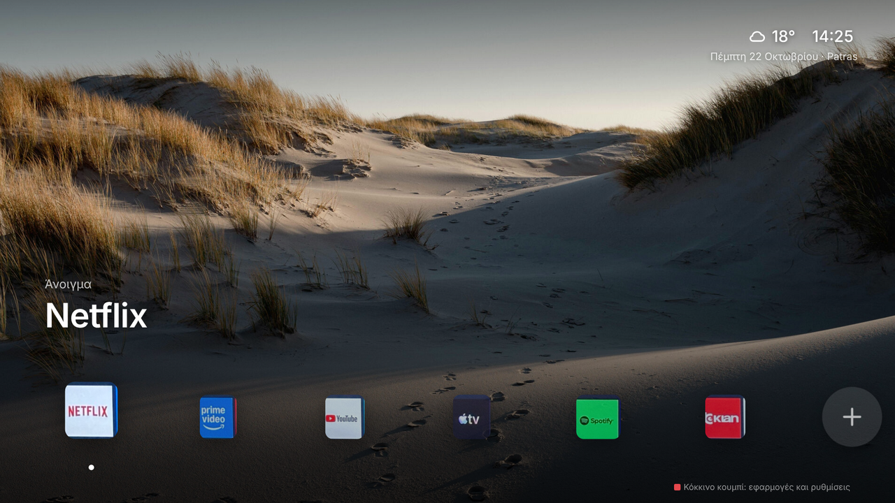
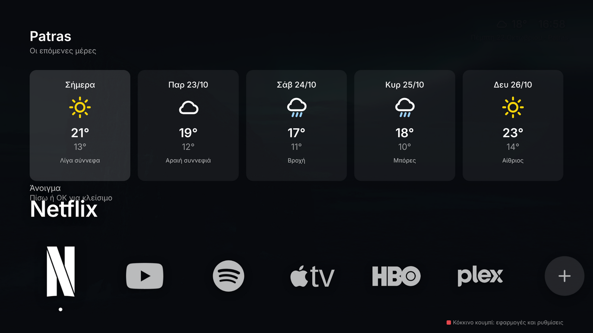
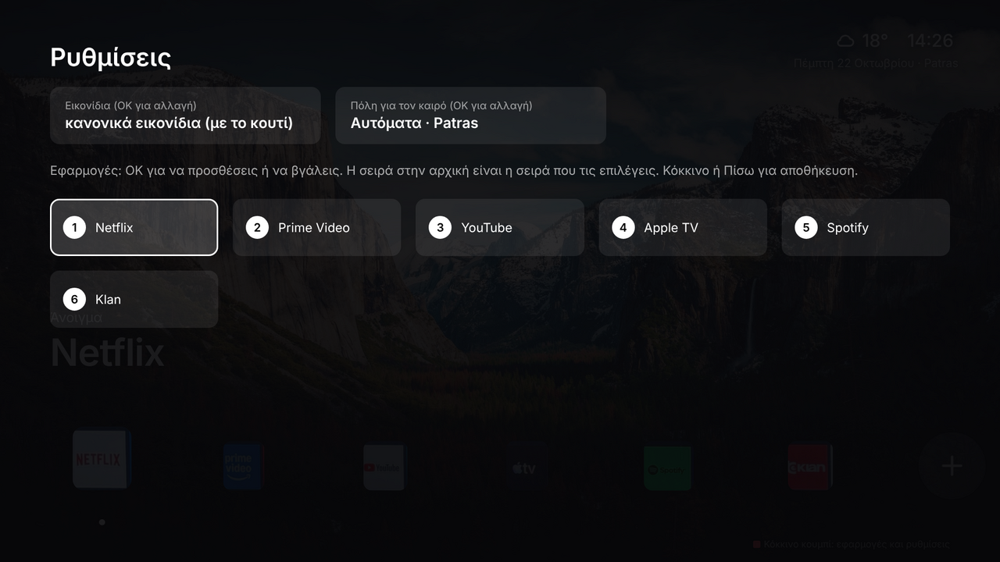

# Home — an Apple TV-style home screen for Samsung TVs

A clean, calm launcher for Samsung Tizen TVs, run through
[TizenBrew](https://github.com/reisxd/TizenBrew). It shows your own apps
over a full-screen photo that changes on its own, with the time and a live
weather forecast — no ads, no rows of "recommended", no clutter.

No root. Nothing is uninstalled. Everything is reversible — remove the
module and your TV is exactly as before.



## Features

- **Full-screen photo background** that changes by itself every 30 seconds, with a slow zoom — like the Apple TV screen saver.
- **Your real app icons**, pulled straight from the TV. Three looks: the icon as-is, the logo only in white, or the logo in its own colours (box removed automatically).
- **Clock and weather**, with the city found automatically from your connection (or set your own).
- **5-day forecast** — press up on the weather, then OK.
- **You choose the apps** and their order. Everything else stays off the screen.
- Works in Greek out of the box (dates, labels, weather descriptions).

### Weather forecast

Press **up** to highlight the weather, then **OK**.



### Settings

Press the **red button** to pick your apps, their order, the icon style, and the weather city.



## Requirements

- A Samsung Tizen TV (2017 or newer) with **full TizenBrew** installed — the module runner, not the standalone TizenTube app.
- Internet (the weather and the photos load from the web).

> **Note:** some older Samsung models block TizenBrew's background services
> (you'll see "Launch Service failed" or a network error). If that happens on
> your set, this launcher — like any TizenBrew module — can't run on it, and a
> cheap Google TV stick is the reliable alternative.

## Install

This is a TizenBrew **module**, so you first need the full **TizenBrew**
app on your TV (the module runner — *not* the standalone TizenTube app),
then you add this module to it.

### Part A — Put TizenBrew on the TV (once)

You need a Windows/Mac/Linux computer on the **same Wi-Fi** as the TV.

1. **Download the TizenBrew Installer** for your computer from
   [reisxd/TizenBrewInstaller → Releases](https://github.com/reisxd/TizenBrewInstaller/releases/latest)
   (e.g. `TizenBrewInstaller-win-x64.exe`). Run it. A terminal window opens and prints
   `Service started`. **Leave it open.**
   On Windows, if double-click closes it, run it from a terminal:
   `cd Downloads` then `.\TizenBrewInstaller-win-x64.exe`.
2. **Find your computer's IP** (`ipconfig` on Windows → *IPv4 Address*, e.g. `192.168.1.14`).
3. **Enable Developer Mode on the TV:** open **Apps**, press **1 2 3 4 5** on the
   remote. Set **Developer mode: On**, and **Host PC IP = your computer's IP**. Press OK,
   then **power-cycle the TV** (unplug for ~15 s). This is what opens the connection.
4. On the computer, open **`http://localhost:8091/ui/dist/index.html`** in a browser.
   Enter the **TV's IP** (TV → Settings → General → Network → Network Status → IP Settings)
   to connect. Approve any **Allow** prompt on the TV.
5. Click **Install TizenBrew** and wait for *Package installed*.
6. Back on the TV, open Developer Mode again (**Apps → 1 2 3 4 5**) and change
   **Host PC IP to `127.0.0.1`**, press OK, power-cycle once more. Now TizenBrew runs
   on its own — the computer is no longer needed.

### Part B — Add this home screen

1. Open the **TizenBrew** app on the TV.
2. Go to **Module Manager** and add the module:

   ```
   gh/iloko10/samsung-home
   ```

   (Or fork this repo and use `gh/<your-username>/samsung-home`.)
3. Open **Home** from the TizenBrew module list. Done.

> Some older Samsung models refuse to launch TizenBrew's background services
> ("Launch Service failed" / network error). That's a manufacturer lock, not a
> setup mistake — on those sets a cheap Google TV stick is the reliable route.

## Remote

| Button | What it does |
| --- | --- |
| Left / Right | Move between apps |
| OK | Open the selected app |
| Up | Highlight the weather → OK opens the 5-day forecast |
| Red | Settings: apps, order, icon style, weather city |
| Yellow / Blue | Move the selected app left / right |
| Green | Check screen — which icons loaded, and why not |

## How the icons work

Most TV app icons are a logo on a coloured box. The launcher reads each app's
own icon from the TV, detects the box colour, and removes it — so only the
logo is left. Pick the style in Settings:

- **white** — every logo in white (default)
- **color** — logos keep their colours (very dark parts turn white so they stay visible)
- **original** — icons exactly as the TV has them, box included

A small helper (`service.js`) runs inside TizenBrew so the page can read the
icon files on the TV. It only answers on the TV itself and only returns image
files. If an icon can't be cleaned up, a simple drawn symbol is shown instead.

## Settings in the code

At the top of the `<script>` in `index.html`:

- `FIXED_CITY` — force a weather city instead of auto-detect.
- `PHOTO_SECONDS` — how long each photo stays (default 30).
- `DEFAULT_ICON_STYLE` — `"white"`, `"color"` or `"original"`.

## Credits

- Background photos: the [elementary OS wallpapers](https://github.com/elementary/wallpapers) collection (originally from Unsplash) — Peter Thomas, David Emrich, Ashim D'Silva, Benjamin Voros, Nattu Adnan, Aniket Deole, Ian Beckley, Paul Carmona, Brendon Porter, Ryan Gorley.
- Weather: [Open-Meteo](https://open-meteo.com). Location: [GeoJS](https://www.geojs.io/) / [ipapi](https://ipapi.co/).
- Runs on [TizenBrew](https://github.com/reisxd/TizenBrew) by Reis Can.

App logos in the screenshots are from [Simple Icons](https://github.com/simple-icons/simple-icons)
and belong to their respective owners; they're shown only to illustrate how
the launcher displays the apps already installed on the TV.
